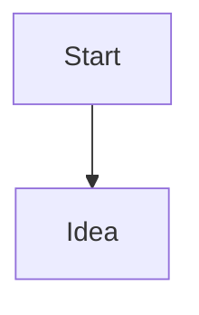

# W1-01 Welcome and how to study

[[Week 1 - Getting started|Week 1]] · next → (W1-02 not built yet)

## Before you watch
> [!question] Before you watch
> 1. What will you do differently in this course from the last one you took?
>
> My answer:

> *Didactic Methods: [[Pretesting]]*

## Start here (1 minute)
> [!tip] The whole thing
> **Takeaway:** short, regular sessions beat long, rare ones.
> - Each week has three lessons and one exercise.
> - Notes are optional; the exercise is not.
> - Ask questions in the course forum.
>
> **Do this next:** block two 30-minute sessions in your calendar this week.

*Come back to this when you fall behind.*

> *Didactic Methods: [[Advance organizer]] · [[Progressive disclosure]]*

## Picture it

> *Didactic Methods: [[Dual coding]]*

## The idea
### How the course is laid out
Three lessons and one exercise per week.

### How to study it
Short, regular sessions; see [[Spacing effect]].

> *Didactic Methods: [[Chunking]]*

## In my life
- When in my week can two 30-minute sessions happen?

> *Didactic Methods: [[Elaboration]]*

## Check yourself
Answer first, then open the toggle and mark 🟢 knew it / 🟡 shaky / 🔴 missed.

What is not optional each week?
The exercise.

> *Didactic Methods: [[Active recall]] · [[Confidence calibration]]*

## Cards
How many lessons are there per week? :: Three, plus one exercise

> *Didactic Methods: [[Spaced repetition]] · [[Active recall]]*

## Teach it back
> [!example] Explain it in 3 sentences without looking
>

> *Didactic Methods: [[Teach-back]]*

## Actions
- [ ] Rate this 1, 2 or 3 in `confidence` and set `last_reviewed` to today

> *Didactic Methods: [[Implementation intentions]]*

## Concepts used
- [[Spacing effect]]

> *Didactic Methods: [[Concept linking]]*

## Source
- [Open the lesson](https://example.com/course/lesson-1) · 6 min
- Review log:
