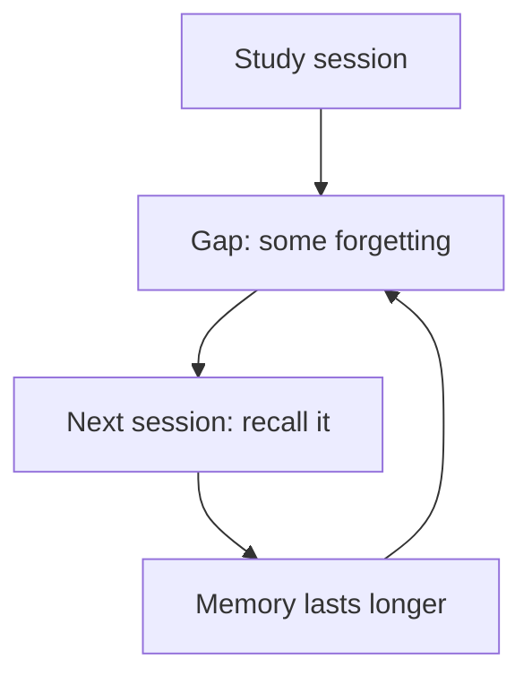

# How spaced practice works

## Before you read
> [!question] Before you read
> 1. Is it better to study something once for two hours, or four times for half an hour?
>
> My answer: four times, I think.

> *Didactic Methods: [[Pretesting]]*

## Start here (1 minute)
> [!tip] The whole thing
> **Takeaway:** spreading the same study time over several sessions makes it last much longer than one long session.
> - Forgetting a little between sessions is part of how it works.
> - The gaps can grow as the material gets easier.
> - Testing yourself in each session adds to the effect.
>
> **Do this next:** split your next study block into two shorter ones on different days.

*Come back to this when you plan a study week.*

> *Didactic Methods: [[Advance organizer]] · [[Progressive disclosure]]*

## Picture it

> *Didactic Methods: [[Dual coding]]*

## The idea
### Same time, more sessions
The total time stays the same; only how it is spread out changes.

### Why the gap helps
Having to work to recall something strengthens it more than an easy re-read. See [[Spacing effect]].

### Growing gaps
Once something comes easily, the next gap can be longer.

> *Didactic Methods: [[Chunking]]*

## In my life
- What do I usually cram, and when could I split it into two sessions?
- Which review would I skip first in a busy week, and how small could it be?

> *Didactic Methods: [[Elaboration]]*

## Check yourself
Answer first, then open the toggle and mark 🟢 knew it / 🟡 shaky / 🔴 missed.

Why does a gap between sessions help?
Recalling something after some forgetting strengthens it more than an easy re-read.

Does spacing need more total study time?
No: the same time, spread over more sessions.

> *Didactic Methods: [[Active recall]] · [[Confidence calibration]]*

## Cards
What is spaced practice? :: Spreading study over several sessions with gaps between them
What can grow as material gets easier? :: The gap before the next review

> *Didactic Methods: [[Spaced repetition]] · [[Active recall]]*

## Teach it back
> [!example] Explain it in 3 sentences without looking
>

> *Didactic Methods: [[Teach-back]]*

## Actions
- [ ] Rate this 1, 2 or 3 in `confidence` and set `last_reviewed` to today

> *Didactic Methods: [[Implementation intentions]]*

## Concepts used
- [[Spacing effect]]

> *Didactic Methods: [[Concept linking]]*

## Source
- Own notes on a study-skills article (paraphrased).
- Review log: 2026-11-20 rated 2.
