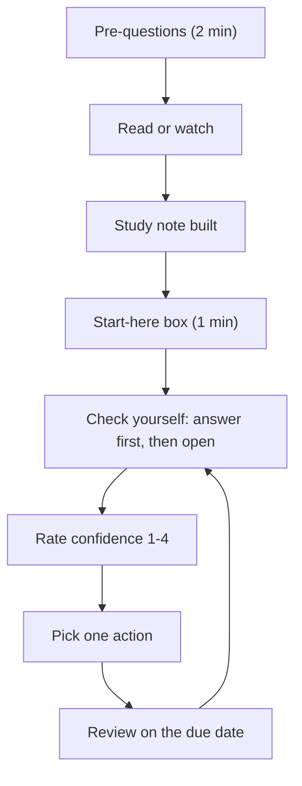

# Start Here

Small, repeatable, low pressure. Only the **Start here (1 minute)** box of each note is required reading; everything else is optional depth.

## The study loop

About 25 minutes per item.

## Rating and review
Set two properties after each review: `confidence` and `last_reviewed` (today). The next review date is computed; you never type it.

| Rating | Meaning | Next review |
|---|---|---|
| 1 | Shaky, missed most | +1 day |
| 2 | Mostly there | +3 days |
| 3 | Solid | +7 days |
| 4 | Locked in: still solid on a repeat review | +21 days |

Use 3 the first time something feels solid. Use 4 only on a later review where it still came without help: that is what stretches the gap to three weeks.

## Low-load rules
- Due list too long? Do the Start-here boxes only. That counts.
- At most 5 check questions and 5 cards per note.
- Mark 🟢 knew it / 🟡 shaky / 🔴 missed in Check yourself; it is just for you.

## Where things live
- [[Review Queue.base|Review Queue]]: due today
- [[Study Notes.base|Study Notes]]: everything, with next review dates
- [[Didactic Methods]]: why each section is there

## Anatomy of a study note
Before you read → Start here → Picture it → The idea → In my life → Check yourself → Cards → Teach it back → Actions → Concepts used → Source.
