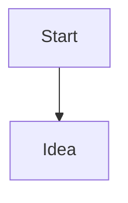

# W1-01 Lesson title

[[Start Here|Week page]] · prev | next

## Before you watch
> [!question] Before you watch
> 1. (pre-question)
>
> My answer:

> *Didactic Methods: [[Pretesting]]*

## Start here (1 minute)
> [!tip] The whole thing
> **Takeaway:** (one sentence)
> - (bullet)
> - (bullet)
> - (bullet)
>
> **Do this next:** (one action)

*Come back to this when ...*

> *Didactic Methods: [[Advance organizer]] · [[Progressive disclosure]]*

## Picture it

> *Didactic Methods: [[Dual coding]]*

## The idea
### Chunk one

> *Didactic Methods: [[Chunking]]*

## In my life
- 

> *Didactic Methods: [[Elaboration]]*

## Check yourself
Answer first, then open the toggle and mark 🟢 knew it / 🟡 shaky / 🔴 missed.

Question?
Answer.

> *Didactic Methods: [[Active recall]] · [[Confidence calibration]]*

## Cards
Question :: Answer

> *Didactic Methods: [[Spaced repetition]] · [[Active recall]]*

## Teach it back
> [!example] Explain it in 3 sentences without looking
>

> *Didactic Methods: [[Teach-back]]*

## Actions
- [ ] Rate this 1, 2 or 3 in `confidence` and set `last_reviewed` to today

> *Didactic Methods: [[Implementation intentions]]*

## Concepts used
- 

> *Didactic Methods: [[Concept linking]]*

## Source
- [Open the lesson](<lesson URL>) · N min
- Review log:
